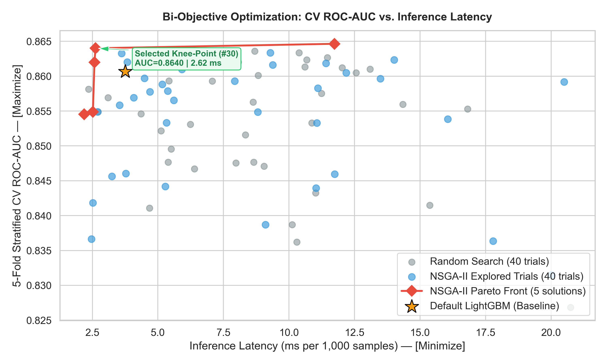

# Multi-Objective Hyperparameter Optimization for Bank Customer Churn Prediction


## 1. Problem Statement
In real-time banking systems, a customer churn prediction model must achieve high classification accuracy while maintaining ultra-low inference latency. Optimizing solely for predictive performance often yields overly complex ensemble models that violate production latency budgets. This project formulates hyperparameter tuning as a **Bi-Objective Optimization** problem to balance predictive power (`ROC-AUC`) and computational efficiency (`Inference Latency`).

## 2. Optimization Formulation
* **Decision Variables ($\mathbf{x}$):** LightGBM hyperparameters:
  * `n_estimators` $\in [50, 500]$ (integer)
  * `max_depth` $\in [3, 12]$ (integer)
  * `learning_rate` $\in [0.01, 0.3]$ (log-uniform)
  * `num_leaves` $\in [15, 127]$ (integer)
  * `min_child_samples` $\in [10, 100]$ (integer)
* **Objective Functions ($\mathbf{f(x)}$):**
  1. $\max f_1(\mathbf{x}) = \text{Mean 5-Fold Stratified CV ROC-AUC}$
  2. $\min f_2(\mathbf{x}) = \text{Median Inference Latency (ms per 1,000 samples)}$
* **Constraints & Evaluation Budget:**
  * Search space bounds defined above.
  * Fixed evaluation budget of $B = 40$ trials per optimization method.
  * Strict hold-out test set isolation (no test set leakage during optimization).

## 3. Dataset
* **Name:** Bank Customer Churn Prediction (`Churn_Modelling.csv`)
* **Source:** Public benchmark dataset from Kaggle (10,000 customer records, 14 attributes).
* **Split Protocol:** 80% Train-Validation (8,000 samples, evaluated via 5-Fold Stratified CV) and 20% Hold-out Test (2,000 samples) with fixed `random_state=42`.

## 4. Optimization Methodology
1. **Baseline 1 (Default Configuration):** Standard LightGBM with default library parameters.
2. **Baseline 2 (Random Search):** `optuna.samplers.RandomSampler` ($B = 40$ trials, `seed=42`).
3. **Proposed Method (NSGA-II):** Multi-objective evolutionary algorithm via `optuna.samplers.NSGAIISampler` ($B = 40$ trials, `seed=42`) to approximate the Pareto-optimal front.

## 5. Key Results
Under an equal evaluation budget of $B = 40$ trials, **NSGA-II** discovered 5 Pareto-optimal configurations that strictly dominate the default LightGBM baseline and outperform Random Search in both convergence speed and Pareto frontier quality[cite: 2, 4, 5].

| Configuration | `n_estimators` | `max_depth` | `learning_rate` | `num_leaves` | `min_child_samples` | 5-Fold CV ROC-AUC | CV Latency (ms/1k) | Hold-out Test ROC-AUC | Test Latency (ms/1k) |
| :--- | :---: | :---: | :---: | :---: | :---: | :---: | :---: | :---: | :---: |
| **Default LightGBM (Baseline)** | 100 | -1 | 0.1000 | 31 | 20 | 0.8606 | 3.7563 | 0.8633 | 2.3043 |
| **NSGA-II #25 (Max-AUC)** | 414 | 4 | 0.0270 | 92 | 35 | **0.8646** | 11.7342 | **0.8703** | 11.3688 |
| **NSGA-II #30 (Selected Knee-Point)** | **83** | **3** | **0.2869** | **82** | **42** | **0.8640** | **2.6185** | **0.8641** | **2.4611** |
| **NSGA-II #21 (Min-Latency)** | 70 | 4 | 0.0302 | 58 | 74 | 0.8545 | **2.1862** | 0.8593 | 2.6057 |

* **Selected Deployment Solution (`Trial #30`):** Achieves higher predictive discrimination than Default LightGBM on both Cross-Validation (`0.8640` vs. `0.8606`)[cite: 2] and unseen Hold-out Test (`0.8641` vs. `0.8633`)[cite: 3], while reducing CV inference latency by **30.3%** (`2.62 ms` vs. `3.76 ms` per 1,000 samples)[cite: 4].



## 6. Repository Structure
```text
pareto-churn-model-optimization/
├── data/               # Dataset (Churn_Modelling.csv)
├── notebooks/          # End-to-end optimization & analysis notebooks
├── results/            # Trial logs (CSV) and summary tables
├── figures/            # Convergence plots and Pareto front visualizations
├── report/             # Final academic report (PDF) and defense slides
├── .gitignore
├── requirements.txt
└── README.md
```

## 7. How to Run
```bash
git clone [https://github.com/DaoNguyenMinhThy/pareto-churn-model-optimization.git](https://github.com/DaoNguyenMinhThy/pareto-churn-model-optimization.git)
cd pareto-churn-model-optimization
pip install -r requirements.txt
jupyter notebook notebooks/01_pareto_optimization.ipynb
```

## 8. Limitations & AI Assistance
* Inference latency measurements depend on local CPU load (mitigated using median over 50-100 repeated inference passes).
* **AI Assistance Disclosure:** Gemini was used to assist in structuring the repository documentation and experiment templates; all mathematical formulations, optimization code, and experimental validations were verified and executed by the author.